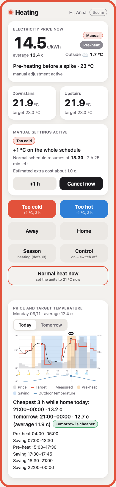

# Using it

Day to day the controller needs nothing. These controls are for days that differ from the schedule.
Each one writes a small file in the app directory that the next run reads, so the page, the command
line and a hand-written file all do the same thing.

| Control | Phone page | Command | File |
|---|---|---|---|
| Too cold / too hot for a few hours | Too cold, Too hot | `--control nudge warmer\|cooler\|longer\|reset` | `NUDGE` |
| Everyone out | Away (the switch) | `--control away on\|off\|<return time>` | `AWAY` |
| Someone home on a weekday | Home (the switch) | `--home today\|week\|<end time>\|off` | `HOME` |
| Holiday schedule | (use Home) | `--control holiday on\|off\|<end time>` | `HOLIDAY` |
| Heating or cooling | Season | `--season heat\|cool` | `SEASON` |
| Normal heat right now | Normal heat now | `--control normal on\|off` | `NORMAL` |
| Leave the units alone | Control | `--control pause on\|hold\|off` | `PAUSE` |

Commands run as `./run.sh <command>` in the app directory, so they also work over SSH from a phone.
Times are local and written like `2026-11-14T18:00`. A file holding anything the controller can't
read is ignored and the error logged, so a typo can't leave the house cold or stuck.

## The phone page

*Made-up data; `.venv/bin/python scripts/phone-screenshot.py` redraws it after a page change.*

The page shows the price now (large), with the price of heat (or of cooling) under the average, the spot price times a factor for the outdoor temperature, when [`[cop]`](configuration.md#the-price-of-heat-cop) (or [`[cool.cop]`](configuration.md#the-price-of-cooling-coolcop)) is on, with the reason for the current setting, each unit's room and
target temperature, the outdoor temperature with a weather symbol, and a chart of the day: the price
(grey), the target (a line in the frame's colour) with the pre-heat and saving stretches shaded, the
measured room temperature so far (dashed), a "now" line, and a strip with the outdoor temperature and the weather. Once tomorrow's prices are out
a Today/Tomorrow switch appears. A frame around the screen shows the state: red for
heating, blue for cooling, grey when the controller is switched off. On a tablet or a desktop the
chart sits beside the controls.

- **The chart is the real plan.** A button redraws it at once with the change. Quarters already past
  show what the controller really set (a quarter without a run is a gap), so a change never redraws
  the past.
- **Overrides.** While a person's setting is in force, a "Manual" chip shows on the price card and a
  card lists each setting: what it does, when normal running resumes, a rough cost or saving, and
  its buttons ("+1 h" and "Cancel now", or cancel). The cost is estimated from the plan's targets
  with and without the setting, at about 2 Wh per degree per unit per quarter
  (`[estimate] wh_per_degree_quarter`; take yours from the [savings report](operations.md#the-savings-estimate)),
  over the quarters whose price is known.
- **Cheapest 3 hours** (for the laundry and the like) looks only in the hours someone is usually home
  (`[web] home_hours_weekday` 17-24, `home_hours_weekend` 07-24; the length is `cheapest_hours`),
  and compares today with tomorrow once tomorrow's prices are out.
- **After a button** the page says how the run went, once it has run (5 seconds or more after the
  press): units updated, delayed because another run was writing (the change then applies at the
  next run), or failed.

The page is in English, or Finnish with `[web] language = "fi"` as the server default. The button in the header
switches it for you only, and the choice sticks to your login on every device. It only writes the control files
and starts a run. Setting it up, and why it must stay behind its proxy: [hosting](hosting.md),
section 3.

## Too cold, too hot

Each press is one step (`[nudge] step`, 1 C) for 3 hours from the last press (`hours`).

- **Too cold** during a saving quarter first lifts the cut back toward the plan, leaving the rest of
  the day alone. Once nothing is cut, a press raises the whole plan, above the normal 22 C if need be
  and up to 24 C. Lift and raise together stay within 2 C (`max`); the page says when a press can do
  no more. While away it lifts the away temperature toward the plan.
- **Too hot** takes back a raise, then a lift, then lowers the plan, down to 2 C under it.
- **+1 h** adds an hour; **Cancel now** returns to the plan straight away.

## Away, Normal, Home

On the page these are one three-position switch: **Away**, **Normal** (the default, the plan as it is) and
**Home**. It shows where you are, and a press moves you:

- **Away** opens the return time. Already away, it opens the return time again, set to the next quarter
  hour, so changing it takes one press. Away replaces Home.
- **Home** asks for how long (today, the week or an end time).
- **Normal** from Home ends Home at once.
- **Leaving Away**, with Normal or Home, is "I am on my way": the return time is set 30 minutes ahead
  and the house starts warming up now, so it is warm when you arrive. Home then applies once away has
  ended. A return time that is already sooner stays.

## Away

For when everyone is out: trips and days out. The house runs at the [nobody-home
floors](how-it-works.md#while-nobody-is-home).

With a return time the rooms [warm up](how-it-works.md#while-people-are-home) before it, sized by how
long the house has been empty (the file records when away started; a new return time keeps it): two
hours out need a quarter of heating, a whole day before a 22 C return about 1 h 45 min, within the
2 hours before the return (`[away] preheat_hours`). After the return time away is over, and the next
run removes the file.

**While cooling, away switches the units off** instead, and on again 2 hours before the return (or
when away is cancelled), with the cooling target in the same write. It only switches on units it
switched off itself: a unit you had switched off stays off, and one someone turns on during the
trip is left on. A failed switch-on is retried every run.

`--plan --away` or `--plan --away-until 2026-11-14T18:00` previews it.

## Someone is home

For sick days, working from home or school holidays: `--home today`, `--home week` (to the end of
Sunday) or `--home <end time>`. Until then:
- weekdays use the weekend schedule;
- price cuts are capped at 0.5 C (no extreme cuts);
- in the daytime (07:00-22:00) heating stays at 20 C or above and cooling at 24.5 C or below,
  whatever the price, sun or unit offset says (`[home]`);
- boosts and pre-heats still apply, and away wins if both are set.

`--plan --assume-home` previews it.

**Holiday** (`--control holiday`, or `touch HOLIDAY`) only switches every day to the weekend
schedule, without the other changes; the page has no button for it, since Home covers a holiday at
home. Cooling has one flat setpoint, so Holiday changes nothing there; Home still keeps cooling at
24.5 C or below in the daytime.

## Season: heating or cooling

You choose, the controller applies it: `--season cool` switches every unit to cooling at the next
run, with the cooling target in the same write, and `--season heat` switches back. Without a
`SEASON` file it heats, so a lost or mistyped file never leaves the house cooling.

It can be changed any time, in either direction (the page asks for confirmation). How firmly the
season is kept is `[control] season_enforce`:

| Value | A unit someone switches off | A unit put in dry, fan-only or auto |
|---|---|---|
| `"always"` (default) | is switched back on at the next run | goes back to the season's mode at the next run |
| `"running"` | stays off | goes back to the season's mode at the next run |
| `"on_change"` | stays off until the season next changes | stays until the season next changes |

With `"on_change"` each unit is switched once when the season changes, heat to cool or back; setting
the season it already has changes nothing, and a unit that couldn't be reached then is switched when
it can be. Units away switched off for a cooling trip are always left to away. If a switch fails,
the next run retries it; until then the unit is controlled in the mode it is in (a multi-split's
group is left alone).

## Normal heat now

A reset for a house gone too hot or too cold: every unit goes to `[normal] temp` (21 C) at once,
whatever the season and the plan say, with the fans at full speed (`fan_full`). Units on one outdoor
unit get one mode from their rooms' average temperature; a self-contained unit goes by its own room:
heat below 21 C, cool above. Units that are off are switched on. When every room has reached 21 C,
or after 4 hours (`timeout_hours`), or when cancelled, the units return to the season's mode, the
plan and auto fans.

## Pause

- `--control pause on` (the page's off switch) writes one safe target to every unit (`[pause]
  heat_temp`, 21 C; cooling units their cooling target), then leaves them alone. A failed write is
  retried at the next run; a unit someone has just changed by hand is not written.
- `--control pause hold`, or `touch PAUSE`, leaves them alone without that write.
- `--control pause off`, or `rm PAUSE`, resumes.

While paused nothing is written, a person's change on a unit stays, and the heartbeat still pings. To
remove the controller entirely, delete its cron line.

## How a change reaches the units

A button writes its file at once and starts a run 5 seconds after the last press (at most 15 seconds
after the first), so presses in a row, or a press and its undo, reach the units as one write. Presses
during a run add one more run after it.
A command (`--control`) only writes the file, and the next cron run applies it. A run takes an
exclusive lock, so two runs never write to the units at once: cron skips its run while another is
going, and a run started from the page waits up to 3 minutes (`--lock-wait 180`). A run that waited but wrote nothing (the lock
stayed taken, the controller is paused, or the circuit breaker is open after repeated failures) exits with code 75, which is how the
page knows the change will apply at the next run.
